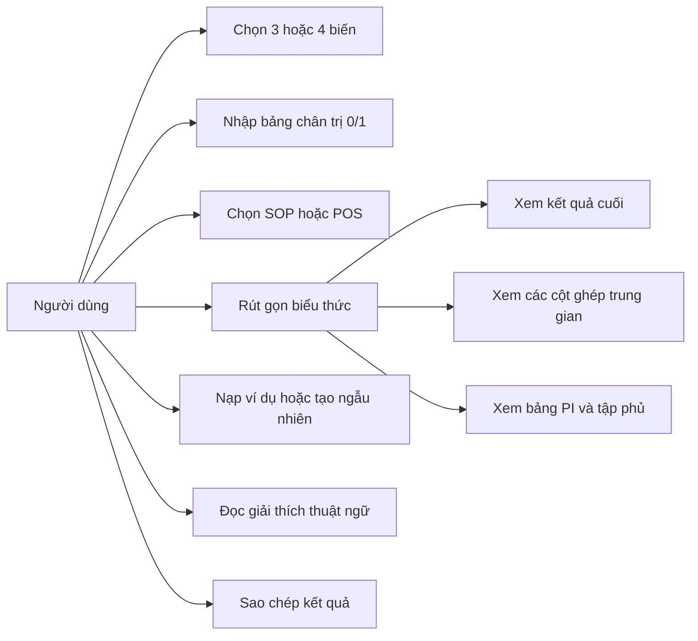
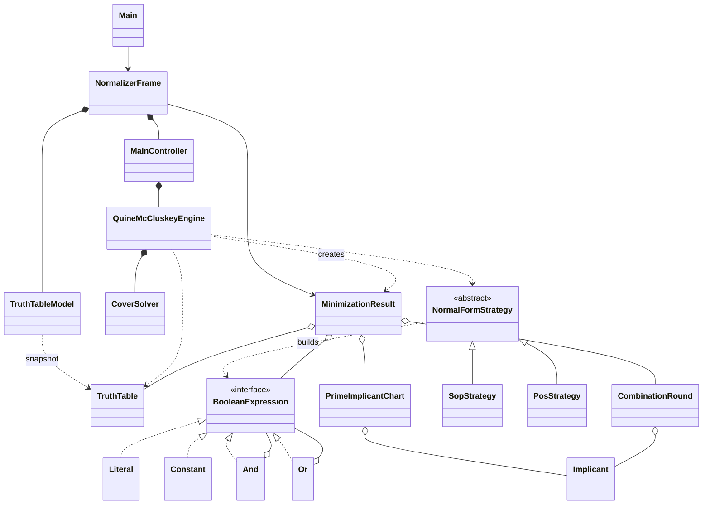
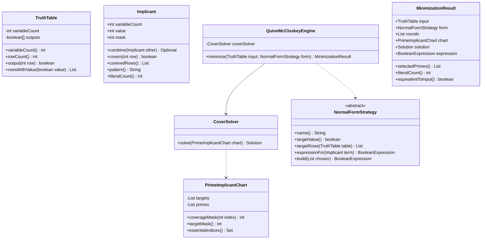
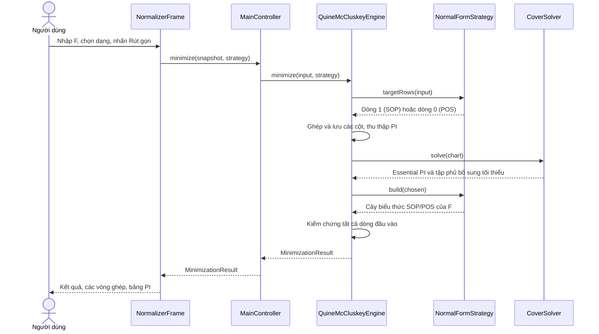

# Thiết kế Logic Lab

Sơ đồ Mermaid dưới đây mô tả bản demo thực tế. Đây không phải file Astah để nộp môn học.

## Use case

Các chức năng tạo ví dụ, ngẫu nhiên, trợ giúp và sao chép là phần bổ sung để thuận tiện học tập. Không có actor quản trị, đăng nhập hay database.

## Tổng quan lớp

`CombinationRound.Entry`, `CombinationRound.Merge` và `CoverSolver.Solution` là các record lồng nhau dùng để lưu snapshot/đáp án. Các loại biểu thức cũng là record lồng trong `BooleanExpression`. Các snapshot và giá trị bất biến có thể chia sẻ đối tượng, nên sơ đồ dùng aggregation cho quan hệ giữ tham chiếu; không khẳng định quyền sở hữu vòng đời độc quyền.

## Các lớp quan trọng

Các trường record được biểu diễn là thành phần giá trị trên sơ đồ; trong Java, trường record thực tế là `private final` và được đọc bằng accessor cùng tên. Collection được sao chép bằng `List.copyOf`/`Set.copyOf`; mảng đầu vào được clone.

## Luồng tính toán

## Các quyết định triển khai

- Với tối đa 16 dòng, dùng bit mask `int` để biểu diễn tập dòng được phủ. Bit `i` là dòng `i`.
- Trong `Implicant`, bit 1 của `mask` là vị trí `x`; các bit cố định lưu trong `value`. Hai cube chỉ ghép khi cùng mask và khác đúng một bit value.
- PI được sắp xếp theo pattern để ID `P1`, `P2` và thứ tự duyệt ổn định.
- Brute force tối ưu số PI trước, số literal sau. Nếu hòa, giữ đáp án đầu tiên và đếm số tập cùng tối ưu.
- POS tối thiểu F' rồi lấy phủ định bằng cách đổi dấu literal và nối OR thành AND. Hằng 0/1 xử lý bằng đối tượng `Constant`.
- Khi người dùng thay đổi đầu vào, xóa trạng thái kết quả cũ và yêu cầu tính lại. Chọn ví dụ, ngẫu nhiên và đổi SOP/POS sẽ tính ngay để tiện khám phá.
- Tính trên Swing EDT vì giới hạn 4 biến và kích thước bài toán nhỏ; không có I/O mạng hoặc công việc dài trong thao tác này.
